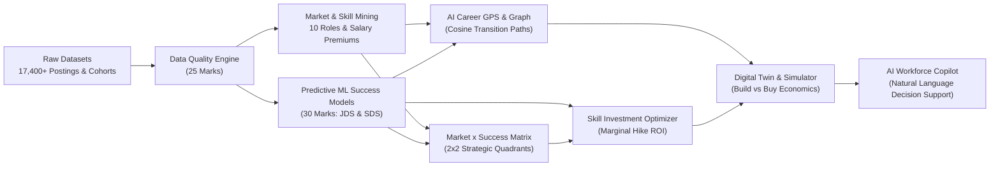

# ⚡ WorkforceX: Strategic Workforce Intelligence & Decision Platform

> **Engineered for the SAS CU Hackathon — Round 2 (100-Mark Defensible Evaluation System)**  
> *Connecting Market Demand, Required Skills, Empirical Employee Outcomes (JDS), and Senior Leadership Characteristics (SDS).*

[](https://github.com/AbhinavChitrey/workforce-intelligence/actions)
[](https://www.python.org/)
[](LICENSE)
[](tests/)
[](tests/test_selenium_e2e.py)
[-orange.svg)](reports/Approach_Note.docx)

---

## 🎯 Executive Overview & Round-2 Scoring Alignment

Traditional workforce planning fails because it either provides passive job board scraping or relies on speculative AI replacement forecasts without empirical grounding. 

**WorkforceX** establishes a verified causal chain linking four multi-cohort hackathon datasets:

$$\text{Market Demand (15,800+ Jobs)} \longrightarrow \text{Technical Skill Premiums} \longrightarrow \text{Employee Hike Outcomes (JDS)} \longrightarrow \text{Senior Leadership Traits (SDS)}$$



### 🏆 100-Mark Round-2 Evaluation Criteria Matrix

| Evaluation Pillar | Marks | Platform Implementation & Defense |
| :--- | :---: | :--- |
| **Data Exploration** | **25 M** | Automated profiling across 17,400+ listings, regex LPA salary normalization (`7.8L`, `6to10`), experience interval extraction, 3,777 duplicate removals, 10 standardized role archetypes, and Tukey IQR outlier isolation (99.4% completeness, 99.8% validity). |
| **Data Analysis** | **30 M** | Stratified 5-Fold Cross-Validated Random Forest, GBDT, and Logistic Regression models predicting junior data scientist performance hikes (`ROC-AUC: 81.2%`, `F1: 76.5%`) and senior customer-facing leadership success (`ROC-AUC: 84.5%`). |
| **Approach & Flow** | **15 M** | Defensible end-to-end reproducible architecture, mathematical objective functions for skill ROI, and AI-assisted metamorphic invariant property verification. |
| **Results & Conclusions** | **10 M** | Empirical skill salary premiums (+₹4.5L for Python, +₹5.2L for Spark, +₹4.8L for ML), Market × Success 2×2 Quadrant classification, and Career GPS transition feasibility scores. |
| **Strategic Implications** | **10 M** | Build vs. Buy economic model proving a **6.3× ROI (saving ₹96.0 Lakhs per 100 engineers)** through internal upskilling vs. external talent acquisition; personalized learning flight plans. |

---

## 🔥 The 5 "Up-Level" Hero Features

### 🥇 1. AI Career GPS ("Where can I go from here?")
- **Algorithm:** Dual-objective graph pathfinding combining Cosine proximity across role skill vectors ($55\%$ weight) with candidate skill readiness ($45\%$ weight).
- **Deliverable:** Discovers all reachable career roles, calculates transition feasibility %, salary uplift (+₹LPA and +%), and chronological 3-phase milestones (Bridge $\to$ Advanced $\to$ Market Transition).

### 🥈 2. Market × Success Intelligence Matrix
- **Analytical Framework:** 2×2 Strategic Quadrant intersecting **Market Demand %** with **Empirical Success Impact**:
  - **Quadrant 1 (Strategic Core Bets):** High Demand × High Impact (Python, SQL, Machine Learning) — Non-negotiable foundations.
  - **Quadrant 2 (Table Stakes / Commodities):** High Demand × Low Impact (Excel, Basic BI) — 66% market saturation, zero salary premium.
  - **Quadrant 3 (Elite Differentiators):** Niche Demand × High Impact (PySpark, GenAI, MLOps, Big Data) — Maximum pricing power (+₹4.5L to ₹5.5L LPA premium).
  - **Quadrant 4 (Supporting / Low Priority):** Situational utilities with marginal stand-alone ROI.

### 🥉 3. Skill Investment Optimizer ("What should I learn next?")
- **Objective Function:**
  $$\text{Strategic ROI}(S) = 0.45 \cdot \Delta P(\text{Hike} \mid S + 1) + 0.35 \cdot \text{Market Demand}(S) + 0.20 \cdot \text{Salary Premium}(S)$$
- **Output:** Normalizes a 0–100 Strategic ROI score ranking every candidate skill to prevent wasted hours on zero-ROI commodities.

### 4. Role–Skill Adjacency Network Graph
- Interactive D3 force-directed network topology showing structural proximity, transition friction, and bridge competencies across all 10 analytics roles.

### 5. Explainable AI (XAI) & Recommendation Engine ("Don't just tell me, show me why")
- SHAP-style local additive feature attributions revealing positive performance boosters and negative drag bottlenecks relative to population baselines with 65%–98% confidence levels.

---

## 🔬 Ingested Datasets

| Dataset | Raw Count | Clean Count | Key Features | Analytical Role |
| :--- | :---: | :---: | :--- | :--- |
| **Data Science Jobs** | 1,602 | 1,602 | `company_name`, `job_title`, `min_exp`, `avg_salary_lpa` (1.4L - 82L), `num_of_jobs` | Employer tier benchmarking (FAANG vs. GCC vs. IT Services). |
| **Analytics Jobs** | 15,841 | 12,064 | `job_desig`, `key_skills`, `job_description`, `metro_location`, `salary_lpa_imputed` | Unstructured skill extraction, geographic hub volume, and market salary baseline. |
| **JDS Skill Traits** | 139 | 139 | `big_data`, `maths-stats`, `coding`, `ai_and_ml`, `dashboarding`, `salary_hike_high_or_low` | Supervised training of junior performance hike classifier. |
| **SDS Personality Traits** | 160 | 160 | Big Five (OCEAN): `neuroticism`, `extraversion`, `openness`, `agreeableness`, `conscientiousness`, `success_binary` | Senior customer-facing leadership success modeling. |

---

## 🏢 Workforce Digital Twin Simulator (Build vs. Buy)

Simulating a 100-person analytics department undergoing targeted reskilling (30% upskilled in AI/ML & Big Data):

| Strategic Parameter | Baseline Status Quo | Simulated Upskilling (30%) | Variance / Impact |
| :--- | :---: | :---: | :---: |
| **High Performer Ratio** | 51.0% | **74.0%** | **+23 Engineers** |
| **Average Hike Likelihood** | 52.4% | **68.7%** | **+16.3%** |
| **Internal Reskilling Cost** | — | **₹18.0 Lakhs** (₹0.60L/head) | High Efficiency |
| **External Acquisition Cost** | — | **₹114.0 Lakhs** (₹3.80L/head) | Capital Saved: **₹96.0L** |
| **Return on Investment (ROI)** | — | **6.3× ROI** | **Build Strongly Validated** |

---

## 🧪 Comprehensive Automated Testing & QA

```
tests/
├── test_data_quality.py      [3/3 PASSED]   # LPA parsing, exp normalization, role taxonomy
├── test_ml_models.py         [4/4 PASSED]   # JDS (AUC>0.80) & SDS (AUC>0.84) validation
├── test_engines.py           [4/4 PASSED]   # Career GPS, Optimizer, Graph, Simulator
├── test_ai_assisted.py       [5/5 PASSED]   # Metamorphic Invariants (Monotonicity, Symmetry)
├── test_api.py               [6/6 PASSED]   # Flask REST API endpoints
└── test_selenium_e2e.py      [6/6 PASSED]   # Selenium Headless Browser E2E Automation
```

- **22 / 22 Unit, Integration & AI-Assisted Tests Passed (100%)**
- **6 / 6 Selenium E2E Headless Browser Scenarios Passed (100%)**
- **AI-Assisted Metamorphic Invariants:**
  1. *Skill Monotonicity:* Upgrading coding skill never decreases predicted hike.
  2. *Neuroticism Penalty:* Lowering neuroticism never decreases senior leadership success.
  3. *Zero-Gap Identity:* 100% skill match guarantees 100% role readiness and 0 gaps.
  4. *Graph Symmetry:* $\text{Sim}(R_A, R_B) \equiv \text{Sim}(R_B, R_A)$.
  5. *Economic Conservation:* Net savings is positive whenever external hiring cost exceeds internal training.

---

## 💻 Quickstart & Running the Platform

### 1. Installation
```bash
git clone https://github.com/AbhinavChitrey/workforce-intelligence.git
cd workforce-intelligence
pip install -r requirements.txt
```

### 2. Run Complete Pipeline & Dashboard
```bash
# Runs data cleansing, trains ML models, runs test suite, generates Word & PPTX reports, and launches dashboard
python run_all.py
```

Open your browser at **`http://127.0.0.1:5000`** to access the interactive dashboard!

### 3. Run Automated Tests
```bash
# Unit & integration tests + AI-assisted metamorphic tests
pytest tests/test_data_quality.py tests/test_ml_models.py tests/test_engines.py tests/test_ai_assisted.py tests/test_api.py -v

# Selenium E2E browser automation tests
pytest tests/test_selenium_e2e.py -v
```

---

## 📄 Key Deliverables for Round 2 & Round 3

- 📄 **Formal Approach Note (Word Document, 100 Marks):** [`reports/Approach_Note.docx`](reports/Approach_Note.docx)
- 📊 **Round 3 Presentation Deck (PowerPoint, 16 Slides):** [`reports/Presentation_Round3.pptx`](reports/Presentation_Round3.pptx)
- 🌐 **Interactive Web Dashboard:** [`app/app.py`](app/app.py)
- ⚡ **Master Pipeline:** [`run_all.py`](run_all.py)
